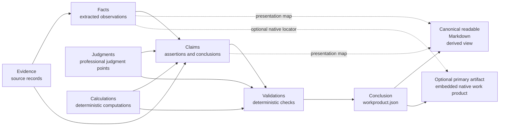
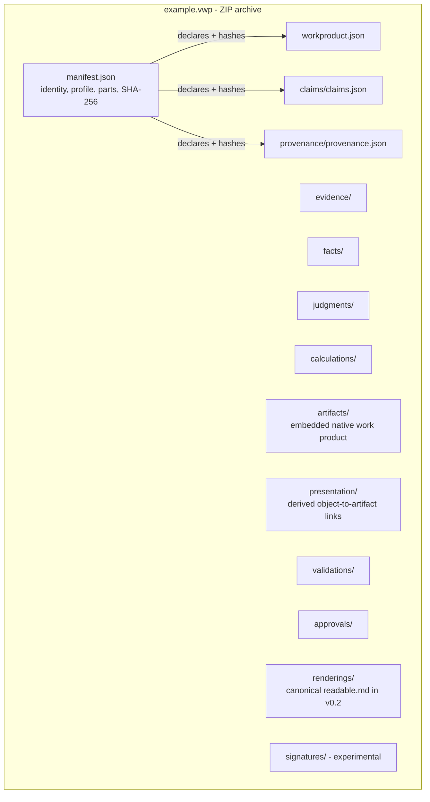

# VWP conceptual model

The package is the source of truth; renderings are derived views. Validators
check structure, integrity, links, and tie-outs — they do not judge whether
the professional conclusion is correct.

